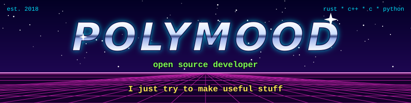

  

  

  <b>Welcome to my homepage!</b> 
  Here I keep fast viewers for satellite, radar and other hard-to-open data, 
  and tools for old file formats that nobody documented. Click a button to visit a project.

  
  
  
  
  
  
  

*Pixels from orbit and from radar, opened in seconds, at any size.*

| Project | What it does | Built with |
|---|---|---|
| **[eoview](https://github.com/polymood/eoview)**  [website](https://polymood.github.io/eoview/) &middot; [download](https://polymood.github.io/eoview/download.html) | Desktop viewer for Earth observation data: GeoTIFF and COG, JPEG 2000, NITF, EOPF Zarr, Sentinel-1, -2 and -3 SAFE, NetCDF-4 and HDF5. A chunk engine streams local files, HTTP and S3 while the interface stays fluid. Time series with a timeline, and a first 3D globe. Installers for Windows, Linux and macOS, with a signed self-update. | Rust, wgpu, egui |
| **[radview](https://github.com/polymood/radview)** | GPU viewer for SAR and ISAR imagery: NITF (SICD, SIDD), TIFF, BigTIFF and COG. Shows complex data as amplitude, phase, I or Q, opens files larger than 10 GB, and has editable color maps with a dB stretch. Release binaries come with checksums and build provenance. | Rust, wgpu, egui |

*Old formats and old engines, treated with respect.*

| Project | What it does | Built with |
|---|---|---|
| **[Smithy](https://github.com/polymood/Smithy)** pre-alpha | Open-source mapping tools for Source engine games, built one useful piece at a time on the way to a Hammer++ replacement. Today: a texture browser that mounts VPKs, game detection from `gameinfo.txt`, lossless VMF round-trip, brush geometry and Python plugins. | C++, Qt 6 |
| **[tim2dump](https://github.com/polymood/tim2dump)** | Extracts PlayStation 2 TIM2 textures to BMP or PNG. Every pixel format, CLUT palettes, mipmaps and batch mode, plus GS register inspection and an ANSI preview in the terminal. | C++ |

*Small tools that do one job well.*

| Project | What it does | Built with |
|---|---|---|
| **[DocumentIndexer](https://github.com/polymood/DocumentIndexer)** | Turns a pile of PDFs into a searchable library. It reads the text layer or runs OCR (Tesseract, or the DeepSeek-OCR vision model on a GPU), detects the language of each document, then feeds a Tantivy full-text index behind a desktop search interface. | Python, PySide6 |
| **[nfod](https://github.com/polymood/nfod)** | An NFO viewer for the terminal. One C file, one compiler command. | C |

Also here: [WerZatSongGUI](https://github.com/polymood/WerZatSongGUI), a desktop interface for WerZatSong, and [beautiful-python](https://github.com/polymood/beautiful-python), annotated examples of clean, idiomatic Python.

  
  
  

  

  Releases, changelogs and build instructions live in each repository. 
  Last updated: October 2026.

